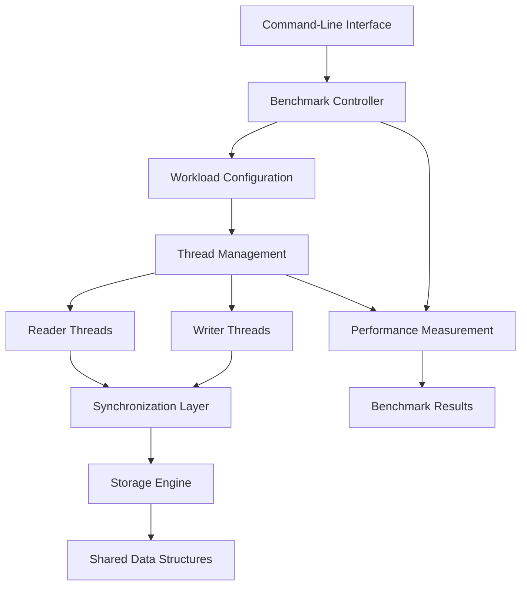

# Kiwi — Multithreaded Storage Engine

[](https://en.wikipedia.org/wiki/C_(programming_language))
[](https://www.kernel.org/)
[](https://man7.org/linux/man-pages/man7/pthreads.7.html)
[](LICENSE)
[]()

## Abstract

Kiwi is an experimental multithreaded storage engine implemented in C for GNU/Linux environments. The project investigates concurrent data access, thread synchronization, mutual exclusion, workload distribution, and performance evaluation using the POSIX Threads (pthreads) API.

The implementation explores the engineering trade-offs between execution parallelism, synchronization overhead, and data consistency under concurrent read and write workloads.

Originally developed as an Operating Systems project at the Department of Computer Science and Engineering, University of Ioannina.

---

## Table of Contents

- [Project Objectives](#project-objectives)
- [System Architecture](#system-architecture)
- [Core Capabilities](#core-capabilities)
- [Technical Implementation](#technical-implementation)
- [Repository Structure](#repository-structure)
- [Build and Execution](#build-and-execution)
- [Performance Evaluation](#performance-evaluation)
- [Project Status and Limitations](#project-status-and-limitations)
- [Development Roadmap](#development-roadmap)
- [Contributing](#contributing)
- [Authors](#authors)
- [License](#license)

---

## Project Objectives

The primary objectives of this project are to:

- Explore concurrent storage operations through thread-level parallelism.
- Implement synchronization mechanisms for shared resources.
- Investigate reader-writer coordination and mutual exclusion.
- Evaluate performance under configurable workloads.
- Examine synchronization overhead and execution efficiency.
- Develop practical experience in low-level systems programming and debugging within GNU/Linux.

## System Architecture

The following diagram illustrates the conceptual execution model of the system.



The architecture separates workload configuration, thread management, synchronization, storage operations, and performance measurement at a conceptual level.

## Core Capabilities

| Capability | Description |
|---|---|
| Multithreading | Concurrent execution using POSIX threads. |
| Mutual exclusion | Locking mechanisms intended to protect shared resources. |
| Reader-writer synchronization | Coordination of concurrent read and exclusive write operations. |
| Workload distribution | Assignment of operations across worker threads. |
| Configurable workloads | Read-only, write-only, and mixed operation scenarios. |
| Performance benchmarking | Execution time measurement and workload evaluation. |
| Benchmark logging | Generation of output files for performance analysis. |

## Technical Implementation

### Thread Management

Thread creation, execution, and termination are managed using the POSIX Threads API.

The implementation uses:

- `pthread_create()` for worker thread creation.
- `pthread_join()` for thread completion and lifecycle coordination.
- `thread_maker()` for workload assignment.

### Synchronization and Mutual Exclusion

The project explores multiple synchronization mechanisms to coordinate access to shared resources:

- POSIX mutexes.
- Condition variables.
- Global locking strategies.
- Peterson's mutual exclusion algorithm as an experimental synchronization approach.

Shared storage operations, including `db_add()` and `db_get()`, incorporate synchronization logic intended to reduce concurrent access conflicts.

### Reader-Writer Coordination

The reader-writer synchronization model is designed around the following principles:

- Multiple readers may access shared resources concurrently.
- Writers require exclusive access to protected resources.
- Condition variables coordinate threads waiting for resource availability.
- Synchronization mechanisms aim to preserve consistency during mixed workloads.

Correctness under all possible thread interleavings has not been formally established.

### Debugging and Reliability

Development involved investigating concurrency-related failures, including:

- Bus errors.
- Inconsistent read operations.
- Shared resource access conflicts.
- Locking and synchronization behavior.

These investigations motivated iterative improvements to the synchronization logic.

## Repository Structure

```text
Kiwi-Multithreading-Search-Machine/
├── docs/                  # Project documentation
├── src/
│   ├── bench/             # Benchmarking and workload execution
│   └── engine/            # Storage engine implementation
├── CHANGELOG.md           # Project change history
├── CODE_OF_CONDUCT.md     # Community conduct guidelines
├── CONTRIBUTING.md       # Contribution guidelines
├── LICENSE                # MIT License
└── README.md              # Project documentation
```

## Build and Execution

### Prerequisites

The intended development environment consists of:

| Dependency | Purpose |
|---|---|
| GNU/Linux | Target operating environment |
| GCC or compatible C compiler | Source code compilation |
| GNU Make | Build automation |
| POSIX Threads | Multithreading and synchronization |
| Git | Version control |

### Clone the Repository

```bash
git clone https://github.com/ChristosGkovaris/Kiwi-Multithreading-Search-Machine.git

cd Kiwi-Multithreading-Search-Machine
```

### Compilation

The original project build procedure uses:

```bash
make all
```

**Build status:** The build procedure requires verification against the current repository. The original build configuration and required dependencies must be available before compilation.

### Benchmark Execution

Once the benchmark executable has been successfully built, the intended command-line interface supports the following workloads.

#### Read-only workload

```bash
./kiwi-bench read <operations>
```

#### Write-only workload

```bash
./kiwi-bench write <operations>
```

#### Mixed read/write workload

```bash
./kiwi-bench readwrite <operations> <write_percentage> <threads>
```

### Command-Line Parameters

| Parameter | Description |
|---|---|
| `operations` | Number of operations to execute. |
| `write_percentage` | Percentage of write operations in a mixed workload. |
| `threads` | Requested number of worker threads. |

### Example Benchmark Configuration

```bash
./kiwi-bench readwrite 10000 50 8
```

This configuration requests a workload of 10,000 operations, a 50% write ratio, and eight worker threads.

## Performance Evaluation

The benchmarking component is intended to investigate the relationship between workload composition, concurrency, and execution performance.

### Evaluation Metrics

| Metric | Purpose |
|---|---|
| Execution time | Measure workload completion time. |
| Throughput | Evaluate operations completed per unit of time. |
| Thread scalability | Examine performance across different thread counts. |
| Workload composition | Compare read-intensive and write-intensive scenarios. |
| Synchronization overhead | Investigate the performance cost of locking. |

Throughput can be calculated as:

```text
Throughput = Completed Operations / Execution Time
```

### Benchmark Methodology

A reproducible performance evaluation should:

1. Establish a single-threaded baseline.
2. Execute equivalent workloads with different thread counts.
3. Maintain consistent workload sizes and execution environments.
4. Repeat measurements to account for runtime variability.
5. Compare execution time and throughput.
6. Validate operation correctness alongside performance.

Quantitative performance results should be accompanied by the hardware configuration, operating system, compiler version, workload parameters, and measurement methodology.

No unverified performance improvements are claimed.

## Project Status and Limitations

Kiwi is an experimental academic systems-programming project rather than a production-ready storage engine.

The following areas require further verification or development:

- Reproducible builds from a clean repository checkout.
- Synchronization correctness under concurrent workloads.
- Deadlock and race-condition analysis.
- Memory safety verification.
- Command-line argument validation.
- Automated regression testing.
- Reproducible performance measurements.

The repository should not be considered production-ready until these areas have been adequately addressed.

## Development Roadmap

- [ ] Restore and verify the complete build configuration.
- [ ] Review mutex and condition-variable usage.
- [ ] Investigate potential race conditions and deadlocks.
- [ ] Validate command-line arguments and error handling.
- [ ] Introduce automated regression tests.
- [ ] Integrate AddressSanitizer and ThreadSanitizer checks.
- [ ] Establish continuous integration through GitHub Actions.
- [ ] Publish reproducible benchmark results.
- [ ] Prepare a validated, versioned software release.

## Contributing

Contributions related to correctness, synchronization, portability, testing, performance evaluation, and documentation are welcome.

Please refer to the following documents before submitting changes:

- [Contribution Guidelines](CONTRIBUTING.md)
- [Code of Conduct](CODE_OF_CONDUCT.md)
- [Changelog](CHANGELOG.md)

## Academic Attribution

This project was originally developed as part of the Operating Systems coursework at:

**Department of Computer Science and Engineering**  
University of Ioannina  
Ioannina, Greece

## Authors

| Author | Affiliation | GitHub |
|---|---|---|
| Christos Gkovaris | University of Ioannina | [@ChristosGkovaris](https://github.com/ChristosGkovaris) |
| Maria Spanou | University of Ioannina | [@SpanouMaria](https://github.com/SpanouMaria) |

## License

This repository is distributed under the MIT License, subject to any applicable third-party licensing requirements.

See the [LICENSE](LICENSE) file for details.